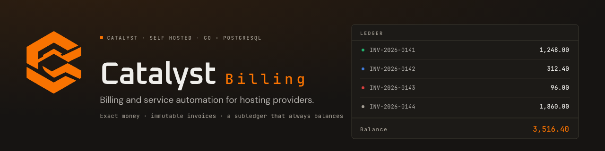

<p align="center">
  
</p>

# catalyst-billing

> ## ⚠️ Experimental — testers only
>
> **This is an experimental billing panel, not a finished product.** It is published so that
> testers and contributors can run it, break it and report what broke. Do not deploy it for real
> customers, and do not point it at a live payment gateway, a real invoice ledger, or money you
> cannot afford to lose.
>
> Concretely, expect: data-loss bugs, schema changes with no migration path between commits,
> behaviour that changes silently, and features that are implemented but only half-reachable.
> Nothing here has been through a security audit or a production soak. If you need a billing
> panel you can trust today, this is not it yet — run it against test data and a test provider
> account, on a host you can throw away.

**A self-hosted billing and service-automation panel for hosting providers.**
One Go binary, PostgreSQL, and a dependency-free TypeScript frontend — built so that
money is exact, the subledger always balances, and a remote provider is never the last
word on what happened.

Part of the [Catalyst](https://catalystctl.com) ecosystem. The mark, palette and typefaces
are the parent's; see [`assets/brand/`](assets/brand/README.md).

---

## Quick start

Prerequisites: **Go 1.26+**, **podman + podman-compose**, **psql**. Node is needed only
when you change the frontend.

```bash
cp .env.example .env
make dev
```

`make dev` starts a dedicated PostgreSQL cluster on port 5442, applies the schema, builds
the binary and the extensions, seeds a demo dataset, and serves the panel in the
foreground at **http://127.0.0.1:8791**. Ctrl-C stops it. It prints the dev sign-in:

```
sign in    admin@dev.local / dev-only-password-1     (demo customers: demo-password-1)
```

Every step is idempotent, and a server left behind by an earlier run is stopped first.

```bash
make dev-reset   # destroy the dev database and start over
make dev-stop    # stop a dev server that outlived its terminal
make seed        # rebuild only the demo dataset (everything under @demo.test)
make help        # every target, one line each
```

Two things make a hand-rolled `serve` look broken; `make dev` handles both. The session
cookie is `Secure`, so over plain http the browser discards it and every request after
sign-in looks unauthenticated (`BILLING_INSECURE_COOKIES=1` — loopback only). And the
provider is stored in the `settings` table, not the environment, so a worker with every
variable set still fails with "missing required configuration" until `servers.provider`
exists.

## What it does

| Area | Guarantee |
|---|---|
| **Money** | Integer minor units with an explicit currency; no binary floats anywhere; exact rational rates; largest-remainder allocation that sums exactly |
| **Billing calendar** | Nominal anchors that never drift, month-end clamping, leap-day annual renewal, DST gap/ambiguity rules, persisted business timezone |
| **Invoices** | Drafts are editable, issued documents are immutable in the database and frozen as JSONB; proforma → invoice conversion; PDF documents |
| **Subledger** | Append-only, balanced per transaction at commit, customer-attributed; balances derived, never stored mutable |
| **Payments** | Verify → persist → process → apply; duplicates absorbed on event id *and* provider payment id; settled amount checked against the recorded checkout |
| **Refunds & credit** | Refundable computed under a row lock; a timeout is `unknown` and posts nothing; credit notes are immutable counter-documents; credit is a subledger account spent by an explicit action |
| **Renewals & dunning** | One invoice per subscription per period, enforced by an index; persisted escalation state; every suspension decision recorded with reason and generation |
| **Off-session charging** | With `gateway.off_session_enabled` on, the worker charges the customer's saved default method for a due renewal in a bounded batch; with it off, nothing is ever charged off-session |
| **Provisioning** | Persisted intent before the remote call; idempotency keys; unknown outcomes reconciled rather than retried; generation fencing stops a stale worker |
| **Orders & fulfilment** | An order is four rows that must agree — what was bought, its items, the invoice it became, the service it delivered — joined by constraints, not by assertion |
| **Commerce** | Catalog with immutable price versions, carts that hold a selection and never a price, coupons with rational percentages, dated tax rates per jurisdiction |
| **Storefront & portal** | A purchase is a clickable path from product page to paid service; `scripts/reachability.sh --check` fails when a served endpoint has no screen or a screen has no way in |
| **Support** | Tickets with threaded messages, attachments, a mail log and auto-close; another customer's ticket is a 404, not a 403 |
| **Identity** | Argon2id, hashed sessions, per-session CSRF, TOTP MFA, API keys as digests, editable roles with four immutable system roles, audited impersonation |
| **OAuth2 & social login** | The panel is an authorization server; a token's scope *is* a permission, intersected with its owner's live permissions, so there is no second authorization path to keep in step |
| **Approvals** | A high-value action can require a second signature from a different operator, recorded as a decision with its reason rather than as a wider permission |
| **Appearance** | A versioned theme document, immutable once published and resolved once per request into a stylesheet, plus a per-tenant brand overlay; the built-in appearance is the byte-identical fallback |
| **Localisation** | Locales and messages are rows, one default enforced by a partial unique index; a missing key falls back to the default locale's text and then to the key — never to an empty string |
| **Marketplace & updates** | An extension is installed only after its digest is verified; a newer version is reported, and applied only once an operator has approved that version |
| **Import** | A migration from another panel is a dry run by default that writes nothing, followed by a row-by-row report of what was created, updated, skipped or refused and why |
| **Audit** | Append-only by trigger, written by the domain service inside the transaction that made the change, credentials redacted by field name |
| **Extensions** | Versioned JSON-RPC over supervised stdio: bounded frames, deadlines, cancellation, crash isolation, clean environment, digest-verified installs |

Every claim above has a test. The ones that matter most are listed under
[`docs/`](#documentation) and named in the package that proves them.

## Design rules

These are the invariants to know before changing anything.

1. **Money never leaves the money package.** `Amount` carries its currency; the zero value
   is invalid, not zero. Arithmetic between currencies fails rather than converts.
2. **Rounding is a parameter, not a default.** Every conversion from an exact rational to
   minor units names its mode, and the mode is recorded on the invoice snapshot.
3. **The database enforces what must never be false.** Journal balance, invoice
   immutability, one-invoice-per-period and provider-payment identity are constraints and
   triggers, not application checks.
4. **A remote call is never the last word.** Provider state is re-queried; an unverifiable
   outcome becomes `unknown` and waits for reconciliation.
5. **A stale worker cannot be destructive.** Destructive transitions compare the service
   generation under a row lock.
6. **Two credentials.** The owner role runs migrations; the runtime role cannot create,
   alter or drop. `billing doctor` fails if that is not true.
7. **A route is a table entry, not a `mux.HandleFunc`.** The registrar applies the wrappers
   the declaration implies, which makes "no route ships without a permission check" a test
   rather than a review habit.
8. **An audit row commits with the change it describes.** A row for a rolled-back change is
   a lie; a change with no row is a gap.

## Commands

| Command | What it does |
|---|---|
| `make dev` | database + schema + binaries + fixtures + demo data, then serve |
| `make test` | `go test ./...` against the real database (`BILLING_REQUIRE_DB=1`) |
| `make test-race` | the same, with the race detector |
| `make test-shard` | one shard of the CI plan: `make test-shard SHARD=3 TOTAL=6` |
| `make test-plan` | prove the CI shards cover every package and every test function exactly once |
| `make verify` | the local gate: fmt, vet, OpenAPI, client, shard plan, race tests, browser smoke, UI e2e |
| `make e2e-ui` | sign in through the form and drive every screen in headless Chromium |
| `make money-e2e` | click the money documents: downloads, the proforma, server CRUD, unlink |
| `make e2e-theme` | paint each theme preset in a real browser (`STAFF_EMAIL`/`STAFF_PASSWORD`) |
| `make smoke` | browser checks that need no database: shell, CSP, routing, asset caching |
| `make openapi` | regenerate `api/openapi.yaml` from the route table |
| `make openapi-check client-check` | fail when the document or the typed client has drifted |
| `make web-build` | rebuild the embedded frontend (needs Node; `web/dist` is committed) |
| `make web-typecheck web-test` | typecheck and unit-test the frontend without emitting |
| `make env-check` | fail when the code reads a variable `.env.example` does not document |
| `make db-psql` / `db-psql-app` | psql as the owner role / as the runtime role |
| `make db-unlock` | clear a test lock leaked by a killed run |
| `make brand-verify` | prove the served brand assets load and render in a real browser |

`billing doctor` is the deploy-time gate: connectivity, schema currency, role privileges,
ledger balance, webhook backlog, and each configured extension's handshake.

## Layout

```
cmd/billing/            serve | worker | migrate | doctor | admin
cmd/openapigen/         the API document, generated from the route table
cmd/apiclient/          the typed client, generated from that document
cmd/vapidkeys/          prints a VAPID key pair for web push

internal/money/         exact amounts, rational rates, allocation, JSON
internal/calendar/      anchors, periods, DST, business timezone
internal/store/         pool, embedded migrations, schema, test harness
internal/paginate/      the keyset cursor every list endpoint uses
internal/settings/      the typed accessor over the settings table

internal/ledger/        balanced append-only subledger
internal/billing/       invoice draft/issue, idempotent payment application
internal/tax/           where a rate comes from, and what to do when it is ambiguous
internal/catalog/       products, categories, immutable price versions
internal/checkout/      payment sessions and recorded expectations
internal/orders/        a catalog price becomes a payable order
internal/commerce/      carts, coupons, currencies, tax rates
internal/coupon/        a promotion on a subscription, applied at renewal
internal/credit/        customer credit as a deposit and as an instrument
internal/creditnote/    credit notes and credit application
internal/payments/      webhook inbox, verification, re-query, saved methods, off-session
internal/refunds/       refund intent, provider call, reconciliation, posting
internal/renewal/       due-work scanner, catch-up guard, cancellation
internal/fulfilment/    a paid invoice becomes the work that delivers it
internal/provisioning/  operation worker, fencing, reconciliation
internal/service/       post-sale lifecycle: cancellations, upgrades, options, limits
internal/dunning/       escalation, holds, suspension eligibility
internal/lifecycle/     the rules that run on a timer and change something on their own
internal/operations/    the worker's other rules: off-session charges, daily telemetry
internal/retention/     deleting bookkeeping rows that have outlived their usefulness
internal/approvals/     the second signature on high-value actions

internal/portal/        the customer-facing view, scoped to the authenticated customer
internal/register/      self-registration and the signed-in password change
internal/customer/      customer records from the operator panel
internal/staff/         the operator read surface
internal/ops/           what is broken, what needs a decision, what ran overnight
internal/tickets/       support tickets, messages, attachments
internal/notify/        durable outbox, templates, in-app inbox, SMTP sender
internal/growth/        affiliates (attribution, commission, payout) and Discord
internal/importer/      migrating a billing history from another panel

internal/authn/         passwords, sessions, MFA, RBAC, API keys
internal/oauth/         the OAuth2 authorization server and social login
internal/captcha/       human challenges: Turnstile, reCAPTCHA, hCaptcha
internal/audit/         who did what, to which record, and why

internal/theme/         the versioned presentation document and its stylesheet
internal/brand/         the per-tenant name, logo and accent colours
internal/i18n/          locales, the message catalog, per-request resolution
internal/invoicepdf/    invoice and credit-note PDFs, with no dependency
internal/marketplace/   digest-verified extension installs
internal/updates/       version reporting, the update check, the approved version
internal/events/        the in-process fan-out behind server-sent events
internal/extproto/      extension protocol, client, supervisor
internal/gatewayconfig/ which gateway and provisioner this install uses, and why

internal/httpapi/       HTTP surface: route table, middleware, handlers
internal/openapi/       the document, generated from the route table
internal/e2e/           the vertical slice, against real extensions and a real database
api/openapi.yaml        the generated API document
api/client/             the generated typed client
web/                    the embedded frontend (see web/README.md)
extensions/             fixtures and adapters: fakegateway, fakeprov, example-hooks, stripe, cpanel, pterodactyl, catalystctl
scripts/                dev, seed, reachability and browser harnesses
docs/                   operator, extension, parity and reachability documents
```

## Testing

The suite runs against real PostgreSQL. There are no in-memory substitutes, because the
constraints, triggers, locking and privilege model *are* the thing under test.

- Each **package** gets its own database (`billing_test_<pkg>`), created on demand; within a
  package, tests serialise on an advisory lock and start from truncated tables.
- The harness **fails** when a migration adds a table it has not classified — an
  unclassified table is exactly how state leaks between tests.
- `internal/e2e` drives the whole slice: real compiled extensions over the real protocol, a
  real database, real webhooks.
- The frontend is proven in a browser. `make e2e-ui` seeds a customer, an invoice, a service
  and a portal login, then fails on a console error, an error state, a screen that renders a
  heading but no content, or a table that overflows a 390px viewport.
- **Reachability is checked, not assumed.** `scripts/reachability.sh --check` diffs the served
  route table against the frontend's and fails on an endpoint no screen reaches, a screen no
  navigation entry reaches, or a button that calls a route the server does not serve. The
  current state is recorded in [`docs/reachability.md`](docs/reachability.md).
- **CI is the same gate, sharded.** `scripts/ci-test.sh` splits the suite six ways — by package,
  and `internal/httpapi` by test name — and every shard gets its own cluster. `make test-plan`
  proves no package and no test function was quietly left out of a shard.

## Limits worth knowing

- **The event broker is process-local.** With more than one instance, a client on A does not
  see an event published on B; fixing that needs a durable log and a per-client cursor.
- **The rate limiter is in-process and fixed-window.** It bounds load; it is not a quota.
- **Extensions are not sandboxed.** A separate process gives crash isolation, not
  confinement. Third-party extensions need a restricted account or container.
- **Off-session charging is opt-in and single-method.** It charges the customer's saved
  default method only, in a bounded batch, and a failed attempt escalates through dunning
  rather than retrying on a schedule of its own.
- **Deferred beyond v1:** a durable job queue, a sandboxed extension runner, multi-tenancy,
  resellers, FX, usage billing, a general ledger.
- **The panel is experimental.** See the notice at the top: no security audit, no production
  soak, and schema changes land without a migration path.

## Configuration

Every variable the code reads is documented in [`.env.example`](.env.example), with the
default the code actually uses and a `REQUIRED` marker on the ones without one. That file is
the reference — a second list in this README would only drift. `make env-check` fails when
the code reads a variable the file does not document.

## Documentation

| Document | Contents |
|---|---|
| [`docs/operations.md`](docs/operations.md) | Deploying, the two database roles, jobs and kill switches, recovery, backup and restore |
| [`docs/extensions.md`](docs/extensions.md) | The extension host: what is enforced, with the test that proves each property |
| [`docs/catalystctl.md`](docs/catalystctl.md) | The CatalystCTL adapter: buying a game server here, then managing it here |
| [`docs/reachability.md`](docs/reachability.md) | What is served, what is reachable, and what is a dead end — plus the sweep that proves it |
| [`docs/ui-gate.md`](docs/ui-gate.md) | Why each API and UI rule exists — the record, not the plan |
| [`docs/theming-system.md`](docs/theming-system.md) | The design of the versioned theme document, its resolution and its stylesheet |
| [`docs/branding.md`](docs/branding.md) | The per-tenant brand overlay and the byte-identical built-in fallback |
| [`docs/paymenter-parity.md`](docs/paymenter-parity.md) | The Paymenter parity backlog, item by item |
| [`docs/parity-status.md`](docs/parity-status.md) | Where that backlog actually stands, verified against the code |
| [`docs/parity-work-packages.md`](docs/parity-work-packages.md) | The path ownership contract that lets the backlog be built in parallel |
| [`docs/parity-audit/`](docs/parity-audit) | The audit tables behind the parity status |
| [`web/README.md`](web/README.md) | The frontend contract: the rules a new screen must follow, the `ctx`, the component kit |
| [`api/openapi.yaml`](api/openapi.yaml) · [`api/client`](api/client) | The generated API document and typed client |
